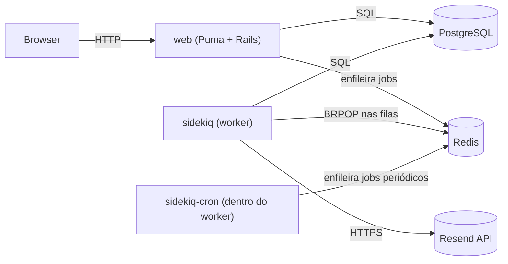
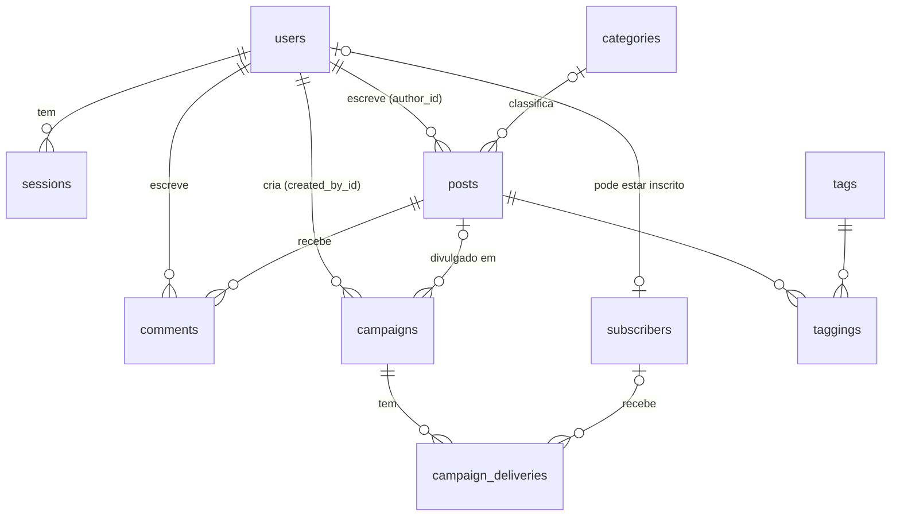
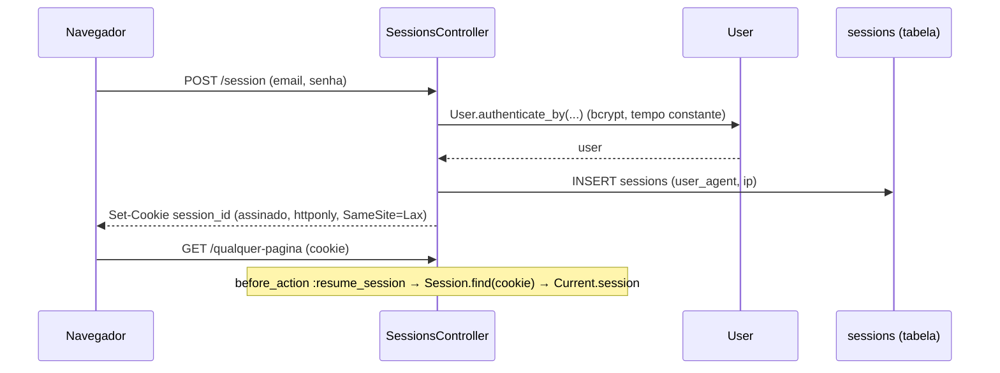
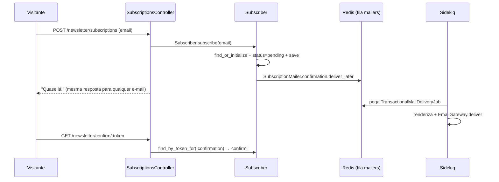
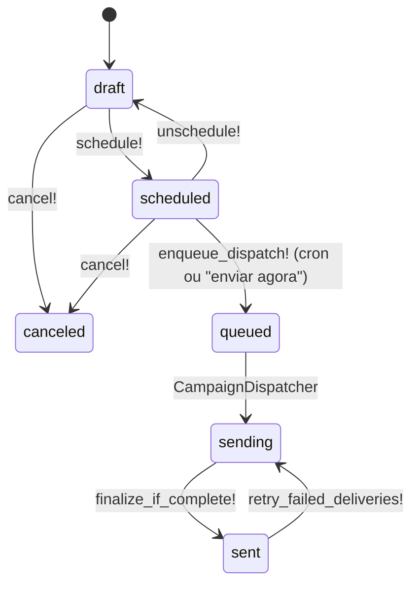
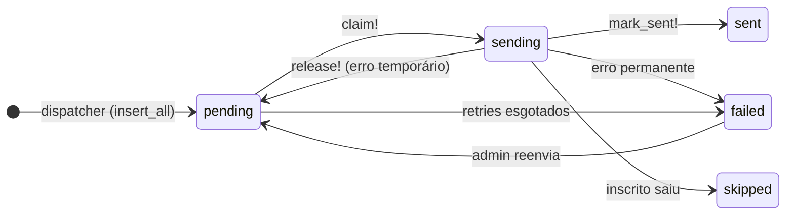
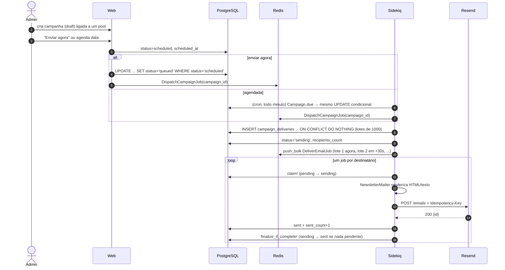
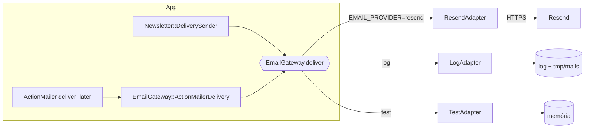

# Arquitetura

Este documento descreve **como o sistema está construído**. As razões de cada escolha e as
alternativas descartadas estão em [DECISIONS.md](DECISIONS.md).

Sumário:
1. [Visão geral](#1-visão-geral)
2. [Diretórios e componentes](#2-diretórios-e-componentes)
3. [Modelo de dados](#3-modelo-de-dados)
4. [Fluxos principais](#4-fluxos-principais)
5. [Sidekiq e Redis](#5-sidekiq-e-redis)
6. [Ciclo completo de uma newsletter](#6-ciclo-completo-de-uma-newsletter)
7. [Retries e idempotência](#7-retries-e-idempotência)
8. [Integrações externas](#8-integrações-externas)
9. [Testes automatizados](#9-testes-automatizados)

---

## 1. Visão geral

É um **monólito Rails** com dois tipos de processo, que usam a mesma base de código:



- **web**: atende HTTP. Nunca envia e-mail durante a requisição; só grava no banco e enfileira jobs.
- **sidekiq**: executa os jobs (e-mails transacionais, campanhas, tarefas periódicas).
- **PostgreSQL**: fonte da verdade. O status de cada envio vive aqui, não no Redis.
- **Redis**: filas do Sidekiq (jobs agendados, retries, dead set) e, em produção, cache.

Camadas dentro do monólito:

```
Controllers  -> recebem HTTP, autorizam (Pundit), delegam e respondem. Sem regra de negócio.
Models       -> validações, associações, scopes e transições de estado atômicas.
Services     -> orquestração que envolve vários models + infraestrutura (newsletter).
Jobs         -> "casca" assíncrona: carregam o registro e chamam o service.
Integrations -> fronteira com o mundo externo (EmailGateway). Nada de regra de negócio.
```

---

## 2. Diretórios e componentes

| Caminho | Responsabilidade |
|---|---|
| `app/controllers/` | Controllers públicos: `posts`, `comments`, `sessions`, `registrations`, `passwords`, `profiles`, `subscriptions`, `unsubscribes`, `health`. |
| `app/controllers/concerns/authentication.rb` | Autenticação por cookie assinado (`session_id`) ligado à tabela `sessions`. Gerado pelo Rails 8 e estendido para que páginas públicas também saibam quem está logado. |
| `app/controllers/admin/` | Namespace administrativo. `BaseController` exige login e `AdminPolicy#access?`. |
| `app/models/` | Active Record. `Campaign` e `CampaignDelivery` concentram as transições de estado do envio. `QueueStats` é um PORO que lê estatísticas do Sidekiq. `Current` guarda a sessão da requisição. |
| `app/policies/` | Pundit. `ApplicationPolicy` nega tudo por padrão; `AdminPolicy` é uma *headless policy* para o namespace. |
| `app/services/newsletter/` | `CampaignDispatcher` (monta destinatários e faz fan-out) e `DeliverySender` (envia um e-mail com segurança). |
| `app/sidekiq/newsletter/` | Jobs Sidekiq nativos (`include Sidekiq::Job`): `DispatchCampaignJob`, `DeliverEmailJob`, `ScheduleDueCampaignsJob`, `RecoverStuckDeliveriesJob`. |
| `app/jobs/` | Jobs Active Job. `TransactionalMailDeliveryJob` é o job usado por todo `deliver_later`. |
| `app/integrations/email_gateway*` | Fronteira com o provedor: `Message`, `Result`, erros, adapters `Resend`/`Log`/`Test` e o delivery method do ActionMailer. |
| `app/mailers/` | `PasswordsMailer`, `SubscriptionMailer` (transacionais) e `NewsletterMailer` (só renderiza; quem envia é o `DeliverySender`). |
| `app/views/` | ERB das páginas e dos e-mails. `layouts/admin.html.erb` é o layout do painel. |
| `lib/admin_constraint.rb` | Restrição de rota para o Sidekiq Web (um app Rack que não passa pelos controllers). |
| `config/sidekiq.yml` | Concorrência e filas com peso. |
| `config/schedule.yml` | Jobs periódicos carregados pelo sidekiq-cron. |
| `config/initializers/sidekiq.rb` | Conexão Redis do client/server e *error handler* que registra toda falha. |
| `config/initializers/email_gateway.rb` | Registra o delivery method `:email_gateway` no ActionMailer. |
| `config/storage.yml` | Serviços do Active Storage (`local`, `amazon`, `test`). |
| `db/migrate/` | Schema com chaves estrangeiras, índices únicos/parciais e *check constraints*. |
| `spec/` | Suíte RSpec (ver seção 9). |

---

## 3. Modelo de dados



| Tabela | Campos importantes | Regras de integridade |
|---|---|---|
| `users` | `email_address`, `password_digest`, `name`, `role`, `bio` | e-mail único; `role IN ('reader','admin')` |
| `sessions` | `user_id`, `ip_address`, `user_agent` | uma linha por login; apagar = logout |
| `categories` | `name`, `slug` | ambos únicos; apagar categoria anula `posts.category_id` (`ON DELETE SET NULL`) |
| `posts` | `title`, `slug`, `excerpt`, `body`, `status`, `published_at`, `comments_count` | slug único; índice `(status, published_at)` para a listagem pública |
| `tags` / `taggings` | `name` / `post_id`, `tag_id` | nome único; par `(post_id, tag_id)` único |
| `comments` | `body`, `status`, `moderated_by_id`, `moderated_at` | `status IN ('visible','hidden')`; cascata ao apagar post/usuário |
| `subscribers` | `email`, `status`, `unsubscribe_token`, `confirmed_at`, `unsubscribed_at`, `user_id` | e-mail e token únicos; `status IN ('pending','confirmed','unsubscribed')` |
| `campaigns` | `subject`, `intro`, `post_id`, `status`, `scheduled_at`, `queued_at`, `started_at`, `finished_at`, contadores, `last_error` | índice `(status, scheduled_at)` para o agendador |
| `campaign_deliveries` | `campaign_id`, `subscriber_id`, `email`, `status`, `attempts`, `locked_at`, `sent_at`, `failed_at`, `provider_message_id`, `last_error` | **único `(campaign_id, subscriber_id)`**; índice parcial em `locked_at WHERE status='sending'` |
| `active_storage_*` | blobs, attachments, variants | tabelas padrão do Active Storage (avatar) |

Observações:
- **Enums em colunas string** (`enum :status, { draft: "draft", ... }`) mais `CHECK constraint`: legíveis no SQL e seguros contra reordenação.
- `campaign_deliveries.email` é uma **cópia** do e-mail no momento do disparo. Se o inscrito for apagado, `subscriber_id` vira `NULL` e o histórico continua.
- Contadores (`sent_count`, `failed_count`, `comments_count`) são desnormalizações para leitura barata. Os de campanha são atualizados com `UPDATE ... SET x = x + 1` (`update_counters`), sem *read-modify-write*.

---

## 4. Fluxos principais

### 4.1 Cadastro, login e sessão



- Logout apaga a linha de `sessions`, o que invalida o cookie no servidor.
- **Reset de senha**: `PasswordsController#create` sempre responde a mesma mensagem (não revela se a conta existe) e envia o e-mail com `deliver_later` (fila `mailers`). O token é assinado, expira e é invalidado quando a senha muda. Após o reset, todas as sessões do usuário são apagadas.
- **Perfil**: trocar a senha exige `password_challenge` (senha atual). O `has_secure_password` faz essa validação.

### 4.2 Autorização

```
Requisição → Authentication (logado?) → Pundit (pode?) → ação
```

- `/admin/*`: `Admin::BaseController` chama `authorize :admin, :access?`. Visitante vai para o login; leitor é redirecionado com alerta (HTML) ou recebe 403 (JSON).
- Post em rascunho: `policy_scope(Post)` o esconde de não-admins. A resposta é **404, não 403**, para não revelar que o post existe.
- `/admin/sidekiq`: o Sidekiq Web é um app Rack montado com `AdminConstraint`. Se a restrição falha, a rota simplesmente não existe (404).

### 4.3 Blog e comentários

- `PostsController#index` usa `Post.visible` (publicado e `published_at <= agora`), `includes` contra N+1 e `page(params[:page])`.
- O corpo em Markdown é renderizado pelo Redcarpet com `filter_html` e depois passa pelo `sanitize` do Rails (defesa em profundidade).
- `CommentsController` só encontra posts visíveis; `CommentPolicy#create?` exige usuário logado.

### 4.4 Inscrição na newsletter (double opt-in)



- O token de confirmação vem de `generates_token_for :confirmation, expires_in: 3.days { confirmed_at }`. Ele é assinado e expira, e por embutir `confirmed_at` vale **uma vez só**.
- O descadastro usa um `unsubscribe_token` aleatório e permanente. O `GET` só mostra um botão (para que antivírus e pré-carregadores de link não descadastrem ninguém). O `POST` executa e também atende o **one-click** do Gmail/Yahoo (header `List-Unsubscribe-Post`).

---

## 5. Sidekiq e Redis

### 5.1 Como funciona

1. **Enfileirar** (no processo web): `Job.perform_async(args)` serializa `{class, args, jid, queue, ...}` em JSON e faz `LPUSH queue:<nome>` no Redis. Leva microssegundos.
2. **Consumir** (no processo sidekiq): cada thread do worker faz `BRPOP` nas filas configuradas, instancia a classe e chama `perform(*args)`.
3. **Falhou?** O middleware de retry captura a exceção, incrementa `retry_count` e grava o job no **sorted set `retry`** com score = horário da próxima tentativa. Um *poller* move jobs vencidos de volta para a fila.
4. **Esgotou os retries?** Executa `sidekiq_retries_exhausted` e move o job para o **dead set** (inspecionável e reprocessável pela UI).
5. **Agendado** (`perform_in`/`at`): vai para o sorted set `schedule` e o mesmo poller o promove quando vence.

Por isso os argumentos são **IDs, não objetos**: o job lê o estado atual do banco quando roda, e o JSON continua pequeno e estável.

### 5.2 Configuração neste projeto

[`config/sidekiq.yml`](../config/sidekiq.yml):

| Fila | Peso | Conteúdo |
|---|---|---|
| `mailers` | 4 | e-mails transacionais (reset de senha, confirmação) — usuário esperando |
| `newsletter_dispatch` | 3 | dispatcher e jobs periódicos (rápidos) |
| `newsletter_delivery` | 2 | um job por destinatário (volume alto) |
| `default` | 1 | demais jobs (ex.: `ActiveStorage::PurgeJob`) |

Com pesos, uma newsletter para 100 mil pessoas **não bloqueia** o e-mail de reset de senha: a fila `mailers` é sorteada 4x mais. `concurrency` (padrão 5) define as threads por processo. Para escalar, suba mais processos `sidekiq`.

### 5.3 Dois estilos de job, de propósito

| | Active Job (`app/jobs`) | Sidekiq nativo (`app/sidekiq`) |
|---|---|---|
| Usado em | `deliver_later` (e-mails transacionais) | newsletter |
| Retry | `retry_on` / `discard_on` (Rails) | `sidekiq_options retry:`, `sidekiq_retry_in`, `sidekiq_retries_exhausted` |
| Vantagem | API padrão do Rails, troca de backend sem mudar código | acesso total ao Sidekiq: `push_bulk`, backoff customizado por erro, callback de esgotamento |

O `TransactionalMailDeliveryJob` usa `sidekiq_options retry: 0`. Assim os retries ficam só com o Active Job (`retry_on ... attempts: 5`), e quando se esgotam o job vai direto para o dead set, sem um segundo ciclo de retries do Sidekiq por cima.

### 5.4 Jobs periódicos (sidekiq-cron)

[`config/schedule.yml`](../config/schedule.yml) é carregado quando o worker sobe:

| Job | Frequência | O que faz |
|---|---|---|
| `Newsletter::ScheduleDueCampaignsJob` | todo minuto | enfileira campanhas agendadas que venceram; reenfileira campanhas `queued` há mais de 10 min |
| `Newsletter::RecoverStuckDeliveriesJob` | a cada 10 min | reenfileira envios presos em `sending` há mais de 15 min (worker morto) |

O sidekiq-cron guarda no Redis o horário do último disparo de cada cron, então vários processos worker não enfileiram o mesmo tick duas vezes. Os jobs periódicos usam `retry: false`: o próximo tick é a nova tentativa.

### 5.5 Monitoramento

- `/admin/sidekiq`: filas, latência, processos, jobs agendados, **retries** (com a exceção e o backtrace), **dead set** e aba **Cron**.
- `/admin`: resumo (processos ativos, enfileirados, retries, mortos, latência por fila). Avisa se nenhum worker estiver rodando.
- `/health`: JSON com `database` e `redis`, retorna 503 se algum cair. `/up` só diz que o processo está de pé.
- **Logs**: o `error_handler` em `config/initializers/sidekiq.rb` registra toda falha (`class`, `jid`, `args`, `retry_count`, erro). O `DeliverySender` loga cada evento com `delivery_id`, `campaign_id`, `attempt` e `provider_message_id`.

---

## 6. Ciclo completo de uma newsletter

### 6.1 Estados





### 6.2 Passo a passo



Em detalhes:

1. **Criação** (`Admin::CampaignsController#create`): rascunho com assunto, introdução e post opcional.
2. **Agendamento** (`Campaign#schedule!`): exige rascunho e, se houver post, que ele esteja **visível** (validação).
3. **Enfileiramento** (`Campaign#enqueue_dispatch!`): `UPDATE campaigns SET status='queued' WHERE id=? AND status='scheduled'`. Só quem altera 1 linha enfileira o `DispatchCampaignJob`. Admin clicando duas vezes ou dois crons simultâneos não geram dois disparos.
4. **Materialização** (`CampaignDispatcher#materialize_deliveries`): para cada lote de 1000 inscritos **confirmados**, um `insert_all` com `unique_by: [:campaign_id, :subscriber_id]` (`ON CONFLICT DO NOTHING`). Isso congela a audiência no momento do disparo.
5. **Início** (`Campaign#mark_sending!`): status `sending` e `recipients_count`. Só acontece **depois** de todas as linhas existirem, o que evita finalizar uma campanha pela metade.
6. **Fan-out em lotes** (`CampaignDispatcher#enqueue_pending_deliveries`): para cada lote de `NEWSLETTER_BATCH_SIZE` IDs pendentes, um `Sidekiq::Client.push_bulk` (uma ida ao Redis por lote). O lote *n* é agendado para `n × NEWSLETTER_BATCH_INTERVAL_SECONDS`, espalhando a carga no provedor (rate limit).
7. **Envio individual** (`DeliverEmailJob` → `DeliverySender`):
   - `claim!`: `UPDATE ... SET status='sending', attempts=attempts+1, locked_at=now WHERE id=? AND (status='pending' OR (status='sending' AND locked_at < now-15min))`. Se não ganhou, sai.
   - Se o inscrito se descadastrou nesse meio tempo: `skipped`.
   - Renderiza com `NewsletterMailer`, converte para `EmailGateway::Message` com `idempotency_key = "campaign-delivery-<id>"` e chama o gateway.
   - Sucesso: `mark_sent!`. Erro permanente: `mark_failed!`. Erro temporário: `release!` + re-raise (Sidekiq agenda o retry).
8. **Finalização** (`Campaign#finalize_if_complete!`): um único `UPDATE ... WHERE status='sending' AND NOT EXISTS (deliveries pending/sending)`. Todos os workers chamam, e só um efetiva.
9. **Histórico**: `/admin/campaigns/:id` mostra contadores, progresso, filtros por status, tentativas, ID do provedor e último erro de cada destinatário. "Reenviar falhas" chama `retry_failed_deliveries!`.

---

## 7. Retries e idempotência

### 7.1 Classificação de erros

Definida em [`app/integrations/email_gateway.rb`](../app/integrations/email_gateway.rb):

| Situação | Erro | Retry? |
|---|---|---|
| Timeout de conexão/leitura | `RetryableError` | sim |
| DNS, conexão recusada/resetada, SSL | `RetryableError` | sim |
| HTTP 5xx, 408, 409 | `RetryableError` | sim |
| HTTP 429 | `RateLimitedError` (com `retry_after`) | sim, após o `Retry-After` |
| HTTP 401/403 | `AuthenticationError` (subclasse de Retryable) | sim, para dar tempo de corrigir a chave |
| Demais 4xx (ex.: 422 e-mail inválido) | `PermanentError` | **não** (vira `failed`) |
| Bug inesperado (ex.: template) | qualquer `StandardError` | sim (libera a linha e deixa o Sidekiq tentar; aparece no painel de retries) |

### 7.2 Política de retry

- **Newsletter** (`DeliverEmailJob`): `retry: 10`, com `sidekiq_retry_in` customizado:
  - 429 → espera `retry_after` + jitter de 0–4 s;
  - demais → `count⁴ + 15 + rand(10)·(count+1)` segundos (a curva padrão do Sidekiq). Isso dá ~15 s, ~30 s, ~1 min, ~2 min, ~5 min, ... e as 10 tentativas cobrem cerca de **4–5 horas** de indisponibilidade.
  - **Jitter** evita que milhares de jobs que falharam juntos voltem todos no mesmo segundo (*thundering herd*).
  - Esgotou: `sidekiq_retries_exhausted` marca o envio como `failed`, grava o erro e tenta finalizar a campanha. O job vai para o dead set.
- **Transacional** (`TransactionalMailDeliveryJob`): `retry_on RetryableError, wait: :polynomially_longer, attempts: 5` e `discard_on PermanentError`.
- **Dispatcher**: `retry: 5`. É seguro porque é idempotente.
- **Periódicos**: `retry: false`, porque o próximo minuto já é a nova tentativa.

### 7.3 Idempotência em camadas

Jobs do Sidekiq têm semântica **at-least-once**: um job pode rodar mais de uma vez (retry após erro, worker reiniciado, job duplicado pela recuperação). O sistema precisa produzir **no máximo um e-mail por destinatário**, então cada camada tem sua proteção:

| # | Camada | Mecanismo | Protege contra |
|---|---|---|---|
| 1 | Campanha | `UPDATE ... WHERE status='scheduled'` (transição condicional) | duplo clique, crons concorrentes |
| 2 | Destinatários | índice único `(campaign_id, subscriber_id)` + `ON CONFLICT DO NOTHING` | dispatcher executado duas vezes |
| 3 | Envio | `claim!` com `UPDATE` condicional; status só avança | dois jobs para o mesmo envio, rodando em paralelo |
| 4 | Provedor | header `Idempotency-Key: campaign-delivery-<id>` (Resend guarda por 24 h) | crash **depois** de enviar e **antes** de gravar `sent` |
| 5 | Contadores | contador só sobe se o `UPDATE` de status afetou 1 linha | contagem dupla |

A camada 4 cobre a janela que nenhum banco resolve sozinho: o efeito externo (e-mail enviado) e a gravação local (`sent`) não estão na mesma transação. O teste `relies on the provider idempotency key when a crash happened after sending` em `spec/services/newsletter/delivery_sender_spec.rb` reproduz exatamente esse cenário.

### 7.4 Por que não segurar um lock durante o envio?

`SELECT ... FOR UPDATE` + chamada HTTP + `COMMIT` manteria uma transação aberta por segundos. Isso esgota o pool de conexões e trava outros processos. O *claim* faz um `UPDATE` curto, a chamada HTTP acontece **fora** de transação, e o `locked_at` com timeout de 15 min é um *lease*: se o worker morrer, outro pode reivindicar a linha.

### 7.5 Jobs perdidos

O Sidekiq open source busca jobs com `BRPOP`. Se o processo for morto à força (`kill -9`, OOM) no meio de um job, esse job some do Redis. (O `super_fetch` do Sidekiq Pro resolve isso.) Aqui a recuperação vem do banco:
- envio em `sending` com `locked_at` antigo → `RecoverStuckDeliveriesJob` reenfileira;
- campanha em `queued` há mais de 10 min → `ScheduleDueCampaignsJob` reenfileira o dispatch.

Em desligamentos normais (`SIGTERM`), o Sidekiq espera `:timeout` (25 s) e devolve ao Redis os jobs não terminados.

---

## 8. Integrações externas

### 8.1 EmailGateway (e-mail)



- **Contrato**: `deliver(EmailGateway::Message) → EmailGateway::Result` ou levanta um dos erros da taxonomia. Regras de negócio só conhecem esse contrato.
- **`Message`**: *value object* imutável (`Data`), montado a partir do `Mail::Message` do ActionMailer (`from_mail`). Os templates continuam em `app/views`.
- **`ResendAdapter`**: `Net::HTTP` com `open_timeout`/`read_timeout`/`write_timeout`, `Authorization: Bearer`, `Idempotency-Key`, log com status e duração, e mapeamento de status HTTP para erros.
- **`LogAdapter`**: padrão em desenvolvimento. Não chama a rede e grava o HTML em `tmp/mails/`. `EMAIL_LOG_FAILURE_RATE` simula falhas.
- **`TestAdapter`**: em memória, respeita `Idempotency-Key` como o provedor real e permite `fail_next(erro, times:)`.
- **Transacionais**: `config.action_mailer.delivery_method = :email_gateway` (dev/prod) faz o ActionMailer usar o mesmo gateway. Em teste é `:test` (padrão do Rails).

Trocar de provedor (SendGrid, SES, Postmark) = escrever um adapter novo e registrá-lo em `EmailGateway::ADAPTERS`.

### 8.2 Active Storage (avatar)

- `has_one_attached :avatar` com variante `:thumb` (96×96, libvips). Validação manual de tipo (PNG/JPEG/WEBP/GIF) e tamanho (2 MB).
- O serviço é escolhido por `ACTIVE_STORAGE_SERVICE` (`local` ou `amazon`). As credenciais S3 vêm do ambiente ou de uma IAM Role.
- Remover o avatar usa `purge_later` (job na fila `default`).

---

## 9. Testes automatizados

- **Ferramentas**: RSpec, FactoryBot, Shoulda Matchers, WebMock (sem HTTP real), SimpleCov, `Sidekiq::Testing` (modo *fake*) e `ActiveJob::TestHelper`.
- **Isolamento**: cada exemplo roda numa transação revertida (`use_transactional_fixtures`). Antes de cada exemplo, as filas fake do Sidekiq são limpas e o gateway vira um `TestAdapter` novo.

| Tipo | Arquivos | Estratégia |
|---|---|---|
| Model | `spec/models` | validações (shoulda), regras e **transições concorrentes** simuladas com duas instâncias do mesmo registro |
| Request | `spec/requests` | HTTP real pela pilha Rails: login via endpoint, cookies, redirects, status; **todas** as rotas admin testadas para visitante, leitor e admin |
| Job (Sidekiq) | `spec/sidekiq` | opções, `sidekiq_retry_in`, `sidekiq_retries_exhausted`, cron, `push_bulk`; fluxo completo com `Sidekiq::Job.drain_all` |
| Job (Active Job) | `spec/jobs` | `retry_on`/`discard_on` com `perform_enqueued_jobs` |
| Service | `spec/services` | lotes escalonados, idempotência do dispatcher, falha temporária/permanente, crash após envio |
| Integração | `spec/integrations` | adapter Resend com WebMock: 200, 401, 422, 429 (+Retry-After), 502 HTML, 503, timeout, `ECONNREFUSED` |
| Mailer/Policy | `spec/mailers`, `spec/policies` | conteúdo, links com token, headers RFC 8058; matriz de permissões |

Rodar: `docker compose run --rm -e RAILS_ENV=test web bundle exec rspec`.
